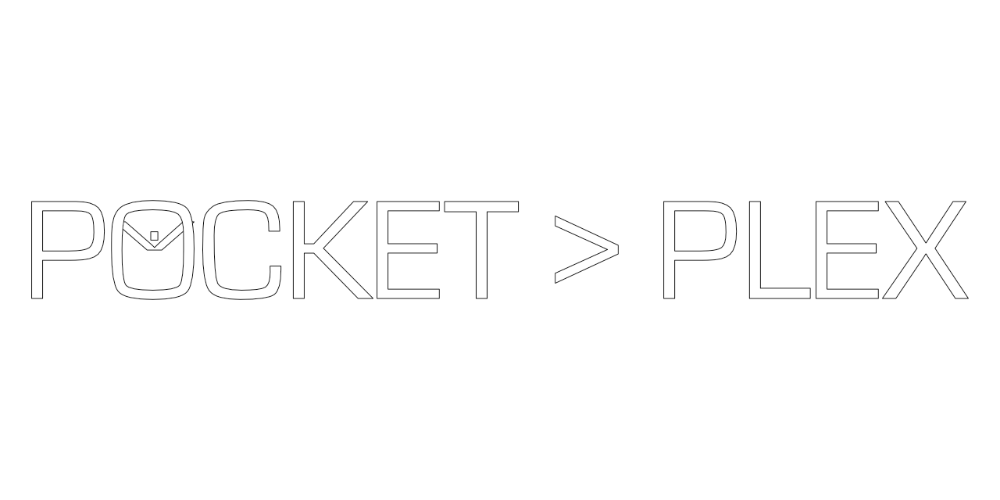
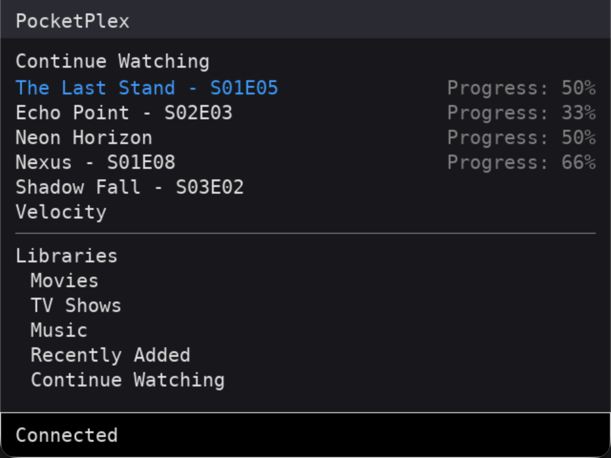

<p align="center"></p>

# PocketPlex

PocketPlex lets you watch your own Plex library on a handheld. It's a small text-menu client. Your Plex server transcodes to a 480p H.264 stream over home Wi-Fi, and the handheld plays it with mpv. You don't need a Plex Pass.



The picture is the desktop build with sample titles.

It runs on two devices today:

| Device | Firmware | Status | Install |
|---|---|---|---|
| Anbernic RG35XX SP | Knulli | Working and tested on the device | [Install on the RG35XX SP](#install-on-the-rg35xx-sp) |
| TrimUI Brick Pro | NextUI | Working and tested on the device | [Install on the TrimUI Brick Pro](#install-on-the-trimui-brick-pro) |

PocketPlex isn't affiliated with Plex Inc. Per-device notes (install, build targets, what differs) are in [docs/devices.md](docs/devices.md).

## What you need

- A Plex Media Server on your home network that can transcode. Hardware transcoding helps, but isn't required.
- On the server, go to Settings → Network and set Secure connections to "Preferred" (not "Required").
- Wi-Fi set up on the handheld.

## Install on the RG35XX SP

You need Knulli. PocketPlex uses the SDL2, SDL2_ttf, libcurl and mpv that Knulli already ships.

1. Get `pocketplex-sp.zip`. Either download it from the `pocketplex-sp-zip` artifact of the latest green GitHub Actions run, or build it yourself (see [Building](#building)).
2. Copy the zip's contents to `/userdata/roms/ports/` on the SD card, or over SSH. You should end up with:
   ```
   /userdata/roms/ports/PocketPlex.sh
   /userdata/roms/ports/pocketplex/   (the binary, assets/, port.json, ...)
   ```
3. In EmulationStation, refresh the list once with Start → Game Settings → Update Gamelists. PocketPlex then appears under Ports.

To update, copy the new zip over the old files. Your `pocketplex/pocketplex.ini` (your login and settings) stays put, because the zip doesn't include one.

## Install on the TrimUI Brick Pro

You need NextUI (the `tg5040` platform). The package is self-contained. It includes its own libmpv and FFmpeg libraries, so there's nothing else to install on the device.

1. Get `pocketplex-tg5040.zip`. Either download it from the `pocketplex-tg5040-zip` artifact of a green build, or build it yourself (see [Building](#building)).
2. Unzip it into `Tools/tg5040/` on the SD card. You should end up with `Tools/tg5040/PocketPlex.pak/`.
3. In the NextUI launcher, open Tools → PocketPlex.

To update, unzip the new package over the old pak. Your login and settings live in the userdata folder (`.userdata/tg5040/PocketPlex/pocketplex.ini`), not in the pak, so they survive.

Launch PocketPlex from the Tools menu, not over SSH. An SSH launch can take input away from the launcher and draw over the video.

## First run

1. Open PocketPlex. The Link screen shows a four-character code.
2. On your phone, go to plex.tv/link and enter the code. The handheld saves its own login: `pocketplex/pocketplex.ini` on the RG35XX SP, and `PocketPlex/pocketplex.ini` in the userdata folder on the Brick Pro.
3. Pick your server from the list. PocketPlex remembers the choice, so later launches open on Home.

## Using it

Home shows Continue Watching and your libraries. Browse to a show, season and episode (or Movies, then the movie), and press A on an item to open its Detail screen. If you've already watched part of it, A gives you Resume or Play from start. Use Up and Down to choose.

### Controls on the RG35XX SP

| Button | Menus | During playback |
|---|---|---|
| D-pad Up / Down | Move | Seek forward or back 5 minutes |
| D-pad Left / Right | Move | Seek back or forward 10 seconds |
| A | Select or play | Pause or resume |
| B | Back one level | Stop and return to Detail |
| L1 / R1 | Page up / down (on Home, L1 opens the server list) | Seek back or forward 1 minute |
| X | Nothing | Show progress |
| Y | Mark watched or unwatched (in Detail) | Nothing |
| Start | Go to Home | Pause or resume |
| Select | Settings | Show progress |
| Menu | Back; on Home, quits | Stop |

The A, B, X and Y buttons follow the labels printed on the SP. If they seem swapped on another device, turn on Swap A/B in Settings.

### Controls on the TrimUI Brick Pro

The labels printed on the buttons are the ones that count. B is the bottom button, A the right one, X the top one and Y the left one.

| Button | Menus | During playback |
|---|---|---|
| D-pad Left / Right | Move | Seek back or forward 10 seconds |
| D-pad Up / Down | Move | Nothing |
| A (right) | Select or play | Pause or resume |
| B (bottom) | Back one level | Stop and return to Detail |
| X (top) | Nothing | Show or hide the time and progress bar |
| Y (left) | Mark watched or unwatched (in Detail) | Nothing |
| L1 / R1 | Page up / down (on Home, L1 opens the server list) | Nothing |
| Select | Settings (on Home) | Show or hide the time and progress bar |
| Start | Nothing | Pause or resume |
| Menu | Quits the app | Stop and return to Detail |

The D-pad left and right are the only seek controls on the Brick Pro. The two extra buttons (F1 and F2) aren't mapped on purpose, so you can assign them to system functions in NextUI.

### Settings

Press Select on Home to open Settings.

- **Video Quality:** 480p (the default, about 1.5 Mbps) or 360p (about 0.8 Mbps, for weaker Wi-Fi).
- **Subtitles:** on by default. When on, PocketPlex burns in the subtitle track you've picked for that item in Plex. When off, it sends none.
- **Swap A/B:** swaps the confirm and back buttons, for devices whose layout is different.
- **Sign Out:** clears the saved login, so the next launch goes to the Link screen.

PocketPlex reports your progress to the server while you watch and when you stop, so Plex and Continue Watching pick up where you left off. Plex ignores positions under about a minute, so a short test won't show up there.

## Troubleshooting

- **PocketPlex isn't in Ports (RG35XX SP):** run Update Gamelists in EmulationStation.
- **Can't reach the server, or errors after the device wakes:** sleep drops Wi-Fi. PocketPlex asks the system to rejoin when the device wakes, and shows "Reconnecting...". Give it up to about 15 seconds, then try again. On the Brick Pro, if Wi-Fi is off, the message tells you to turn it on in NextUI Settings.
- **Low quality or stutter:** check Settings → Video Quality, and make sure your server can transcode in real time.
- **Playback fails with "loading failed":** check the log. On the Brick Pro, a missing `lib/` folder or a missing `PP_CA_PATH` is the usual cause.
- **Logs:**
  - RG35XX SP: `/userdata/roms/ports/pocketplex/log.txt`
  - Brick Pro: `/mnt/SDCARD/.userdata/tg5040/logs/PocketPlex.txt`

  Both log screen changes, button presses and playback. Tokens are redacted.
- On the SP, a line at startup that says `/usr/lib64/libcurl.so.4: no version information available` is harmless.

## Configuration file

On the RG35XX SP, `pocketplex.ini` sits next to the binary. On the Brick Pro it's in the userdata folder, and the launcher points `POCKETPLEX_INI` at it. You shouldn't need to edit it by hand. The keys are `[plex] server_url, token, client_id` and `[ui] quality = 480p|360p, subtitles = burn|off, swap_ab = true|false`. There's an example in `pocketplex.ini.example`. The file holds your Plex token, so don't share it or commit it. It's in `.gitignore`.

---

## Building

For the desktop (macOS or Linux), you need SDL2, SDL2_ttf and libcurl. On a Mac, `brew install sdl2 sdl2_ttf`.

```bash
make                 # app and tools for PLATFORM=desktop: build/pocketplex, build/pp-cli
make test            # unit tests (no network)
make run             # run the desktop app
```

On the keyboard, the arrow keys are the D-pad, Enter is A, Backspace is B, a, z and x are the other buttons, PgUp and PgDn are L1 and R1, s is Start, p is Select, and Esc is Menu.

Device packages are cross-compiled in Docker. Docker Desktop or OrbStack needs to be running, and you only need it for these targets:

```bash
make docker-sp       # dist/pocketplex-sp.zip        (aarch64, RG35XX SP and Knulli)
make docker-tg5040   # dist/pocketplex-tg5040.zip    (aarch64, TrimUI Brick Pro and NextUI; glibc 2.23 or older)
```

The Brick Pro image also builds libmpv 0.36 (OpenGL render API, ALSA audio) and FFmpeg 6.1 with mbedTLS under LGPL v3 (`--enable-version3`). CI (`.github/workflows/build.yml`) builds the desktop, SP and MMP packages on every push and uploads the zips as artifacts.

Developer tools:
- `build/pp-cli` is a headless client for a real server. Commands: `login`, `servers`, `ls [key]`, `ondeck`, `url <rk>`, `stop <session>`, `progress <rk> <ms>`, `watched <rk>`, `unwatch <rk>`. It reads `pocketplex.ini`, or the file named in `POCKETPLEX_INI`.
- App smoke modes: `--smoke-scroll`, `--smoke-walk` (a real server, Library to Episode and back), `--smoke-link` (fake data), `--smoke-play <ratingKey> [--play-seconds N]`, and `--exit-after-ms N`.

A change is ready to merge when `make`, `make test`, `make docker-sp` and `make docker-tg5040` all finish with 0 compiler warnings. GCC catches warnings that macOS's clang misses, so the device builds matter. `make inspect-tg5040` checks that the Brick Pro binary needs glibc 2.23 or older.

## Status and roadmap

- **RG35XX SP (done):** PIN login, server discovery with friendly names, Movies and TV browsing, transcoded playback at 640×480 (no dropped frames in a 10-minute soak), pause, seek and exit from the buttons, resume, watch-progress sync, subtitles on or off, and the Nintendo button layout.
- **TrimUI Brick Pro (done, on the device):** PIN login, server choice, browsing, full-screen UI, smooth hardware-accelerated video through libmpv with a clean hand-off back to the launcher, the controls above, watch-progress sync, the Wi-Fi-off message, and a self-contained package.
- **Next:** music mode (Artist, Album, Track, and now-playing).
- **Later:** poster thumbnails, on-screen keyboard search, and Plex Home users.
- Smaller known issues are in [`docs/BACKLOG.md`](docs/BACKLOG.md).

## Project docs

- [`docs/devices.md`](docs/devices.md): per-device summary (install, build target, what differs, status) and the measurements behind the RG35XX SP's player, buttons, display hand-off and soak results.
- [`docs/BACKLOG.md`](docs/BACKLOG.md): smaller findings that aren't fixed yet.
